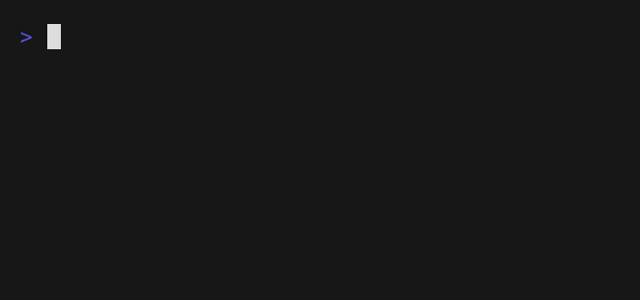

# Cash


# What to Do

Suppose you work in a shop and a child buys a candy for `0.36€`.
He gives you a `1€` coin, so you have to give him `64` cents back. 
Knowing that you have coins of `50`, `20`, `10`, `5`, `2` and `1` cents, you have several ways of giving change.

For instance:
- `64 = 64x1` (64 coins)
- `64 = 1x2 + 62x1` (63 coins)
- ...
- `64 = 2x20 + 2x10 + 1x2 + 2x1` (7 coins)
- `64 = 3x20 + 1x2 + 2x1` (6 coins)
- `64 = 3x20 + 2x2` (5 coins)
- `64 = 1x50 + 1x10 + 2x2` (4 coins)

In a file called `cash.py`, implement a program that asks the user for an amount of change, in cents, then prints the minimum number of coins needed to give it back, as in the below:



Re-prompt the user, again and again as needed, if their input is not between 1 and 99 included (or if their input isn’t an `int` at all!).
Don't use `try/except` structure, it's not needed here. A `while` loop is ok.

```bash
$ python cash.py
Amount: 103
Amount: -2
Amount: 26
3
```

> [!TIP]
> To check that a string (`str`) contains only digits, you may use `isdigit()`. ([Python ref](https://docs.python.org/3/library/stdtypes.html#str.isdigit))

> [!TIP]
> If you already know how to change money, you certainly use the so called **greedy algorithm**. 
> As its name says, it consists in taking the locally optimal choice.
> 
> You begin with the greater coin (`50` cents), if its value is too high for the amount, try the next coin, etc. Once you find a suitable coin, count +1 and remove the value from the amount and retry until the amount is 0.
> 
> Be careful, a greedy algorithm is not always correct, ask yourself why (or ask chatGPT but never trust it).

```bash
$ python cash.py
Amount: 24
3
```
> [!TIP]
> How many `50` cents appear in `64`? Well as simple as `64 // 50 = 1` (and you're left with `64 % 50 = 14` cents).

# How to Test

Test your program from the exercise folder with:

```bash
python test_cash.py
```

(use `python3` instead of `python` if that is how you run Python on your computer).

The script runs your program as a user would: it types some answers to the `Amount: ` question, then checks what your program prints.
When a test fails, it explains what is wrong and shows the expected change (e.g. `64 = 1x50 + 1x10 + 2x2, so 4 coins`).

Don't forget it's important to test your program yourself too.
What happens if the user input is :
* `-1` ?
* `0` ?
* `1` ?
* `4` ?
* `5` ?
* `24` ?
* `99` ?
* `127` ?
* letters or words?
* nothing at all?

# How to Submit

Once you're done with all tasks, submit all your python files on Moodle

# Licence

This course is freely inspired by [CS50’s Introduction to Computer Science](https://cs50.harvard.edu/x/2025/) Harvard. It is licensed under a [CC BY-NC-SA 4.0](https://creativecommons.org/licenses/by-nc-sa/4.0/) license. 
